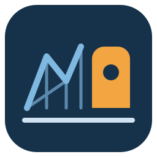
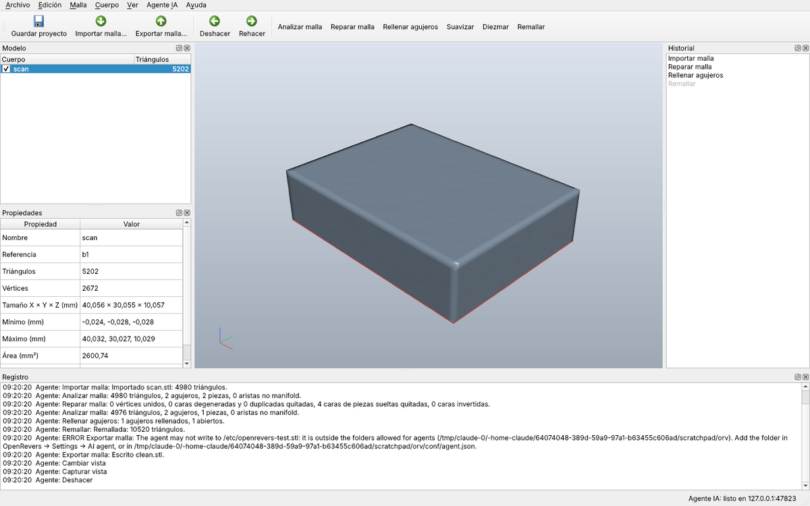

# OpenRevers

**Ingeniería inversa de mallas escaneadas, en local y con código abierto.**
*Reverse engineering of scanned meshes — local and open source. [English below](#english).*

OpenRevers convierte una malla escaneada en una pieza que se puede imprimir en
3D o mecanizar en CNC. Es un programa de escritorio nativo (C++ y Qt) que
funciona **entero en tu equipo** y que un agente de IA (Claude u otro
compatible con MCP) puede manejar paso a paso, delante de ti.

> **Estado: versión 0.3, fase 2 de 5.** Prepara mallas y nubes de puntos
> (análisis, reparación, relleno, suavizado, diezmado, remallado que conserva
> las aristas vivas, quads y T-Spline, Poisson), encuentra las formas de la
> pieza (planos, cilindros, conos, esferas, toros) y la alinea (3-2-1 y mejor
> ajuste), con proyecto, deshacer y servidor MCP. El sólido paramétrico
> (STEP), las superficies libres y la inspección llegan en las fases
> siguientes: consulta la [hoja de ruta](docs/hoja-de-ruta.md).

## Qué hace (versión 0.3)

| Área | Funciones |
| --- | --- |
| Archivos | Importar STL (binario y texto), OBJ, PLY (texto y binario) y 3MF; nubes de puntos E57, XYZ, PTS, PLY y OBJ; exportar STL, OBJ, PLY, 3MF y XYZ; proyecto `.orvp` con todos los cuerpos |
| Análisis | Agujeros y su tamaño, bordes abiertos y no manifold, caras degeneradas, duplicadas e invertidas, piezas sueltas, área, volumen, longitud media de arista |
| Reparación | Unir vértices, quitar caras defectuosas y piezas sueltas, orientar las caras hacia fuera, rellenar agujeros con un parche suave |
| Procesado | Suavizado laplaciano, diezmado con error máximo, remallado uniforme o adaptativo conservando las aristas vivas, remallado en quads |
| Formas | Segmentación automática y ajuste de planos, esferas, cilindros, conos y toros con su σ; medir entre formas |
| Alineación | Ejes principales, 3-2-1 por datums (caras, ejes, centros) y mejor ajuste (ICP robusto) con informe de desviación |
| Nubes de puntos | Aclarar, calcular y orientar normales, reconstruir una malla cerrada (Poisson apantallado) con recorte de lo que no estaba escaneado |
| Sólido paramétrico | Piezas con historial: bocetos de rectas, arcos y círculos; extruir, cortar, revolución y redondeos; parámetros con nombre; comparar con el escaneo; exportar e importar STEP (Open CASCADE). Secciones de la malla para dibujar los bocetos |
| Superficies | Exportar una malla de quads cerrada como T-Spline (`.tsm`) para Autodesk Fusion |
| Trabajo | Deshacer y rehacer de cada operación, historial, registro, visor 3D con bordes abiertos marcados |
| IA (MCP) | 57 herramientas con la ventana abierta (ve lo que señalas con el ratón), capturas de la vista para el agente, guía de trabajo, carpetas permitidas |
| Idiomas | Español e inglés |

## Instalación

### Windows

1. Descarga `OpenRevers-<versión>-win64.exe` de la página
   [Releases](https://github.com/MakerManiac3d/OpenRevers/releases), o del
   último artefacto **OpenRevers-Windows** en
   [Actions → Build](https://github.com/MakerManiac3d/OpenRevers/actions/workflows/build.yml).
2. Ejecútalo y sigue el asistente. Instala el programa y su puente para IA,
   `openrevers-cli.exe`, en la misma carpeta.
3. Windows SmartScreen avisará de que el instalador no está firmado:
   *Más información → Ejecutar de todas formas*.

También hay un `.zip` portátil, que funciona sin instalar.

### Linux y macOS

Por ahora, se compila desde el código: [docs/desarrollo/compilar.md](docs/desarrollo/compilar.md).

## Uso

1. **Archivo → Importar malla** (o arrastra el archivo a la ventana).
2. **Malla → Analizar malla**: qué le pasa al escaneo.
3. **Malla → Reparar malla**, después **Rellenar agujeros**.
4. Si hace falta, **Suavizar**, **Remallar** o **Diezmar**.
5. **Archivo → Exportar malla** o **Guardar proyecto**.

Cada paso se deshace con Ctrl+Z. El manual completo:
[docs/usuario/es/manual.md](docs/usuario/es/manual.md).

## Trabajar con un agente de IA

En OpenRevers, menú **Agente IA → Copiar configuración para Claude Desktop**
(o **Copiar comando para Claude Code**), pégalo donde indica y reinicia
Claude. Después basta con pedírselo: *«Abre C:\Escaneos\soporte.stl, repáralo,
cierra los agujeros pequeños y exporta el resultado»*. Lo verás hacerlo en la
ventana, y cada paso se puede deshacer.

Detalles, herramientas y seguridad: [docs/mcp/README.md](docs/mcp/README.md).

## Privacidad

OpenRevers **no se conecta a internet**: sin telemetría, sin comprobación de
actualizaciones, sin cuentas. El agente se conecta solo por `127.0.0.1` con un
token, y solo puede leer y escribir en las carpetas que autorices. Lo único que
sale del equipo es lo que el agente de IA lee, que va a su proveedor del modelo.

## Documentación

| Documento | Contenido |
| --- | --- |
| [Manual (es)](docs/usuario/es/manual.md) · [Manual (en)](docs/usuario/en/manual.md) | Uso del programa |
| [docs/mcp](docs/mcp/README.md) | Conectar un agente de IA, herramientas, seguridad |
| [docs/desarrollo](docs/desarrollo/arquitectura.md) | Arquitectura, compilación, formato de proyecto, rendimiento con mallas grandes, cómo añadir un comando |
| [docs/algoritmos](docs/algoritmos/mallas.md) | Cada algoritmo, su referencia bibliográfica y sus límites (mallas; [formas y alineación](docs/algoritmos/primitivas.md)) |
| [Hoja de ruta](docs/hoja-de-ruta.md) | Las cinco fases |
| [THIRD_PARTY.md](THIRD_PARTY.md) | Librerías de terceros y sus licencias |
| [CHANGELOG.md](CHANGELOG.md) | Cambios por versión |

## Licencia

**GNU GPL v3 o posterior** ([LICENSE](LICENSE)). Puedes usarlo, estudiarlo,
modificarlo y redistribuirlo; quien distribuya una versión modificada debe
publicar su código con la misma licencia. Las librerías de terceros conservan
sus licencias ([THIRD_PARTY.md](THIRD_PARTY.md)).

**Permiso adicional (sección 7 de la GPL):** OpenRevers puede cargar en
tiempo de ejecución las bibliotecas de escaneo que instala CrealityScan; el
texto está en [LICENSE-EXCEPTION.md](LICENSE-EXCEPTION.md). Esas bibliotecas
no se distribuyen con OpenRevers.

© 2026 MakerManiac3d.

---

## English

OpenRevers turns a scanned mesh into a part you can 3D print or machine. It is
a native desktop program (C++ and Qt) that runs **entirely on your computer**,
and that an AI agent (Claude or any MCP client) can drive step by step, in
front of you.

**Status: version 0.3, phase 2 of 5** — prepares meshes and point clouds
(analysis, repair, hole filling, smoothing, decimation, edge-preserving
remeshing, quads and T-Splines, Poisson), finds the part's shapes (planes,
cylinders, cones, spheres, tori) and aligns it (3-2-1 and best fit), with
projects, undo and an MCP server. Parametric solids (STEP), freeform
surfaces and inspection follow ([roadmap](docs/hoja-de-ruta.md)).

- **Install (Windows):** run `OpenRevers-<version>-win64.exe` from
  [Releases](https://github.com/MakerManiac3d/OpenRevers/releases) or the
  latest **OpenRevers-Windows** artifact of the Build workflow.
- **Build from source:** [docs/desarrollo/compilar.md](docs/desarrollo/compilar.md) (bilingual).
- **Manual:** [docs/usuario/en/manual.md](docs/usuario/en/manual.md).
- **AI agents:** menu **AI agent → Copy configuration for Claude Desktop**;
  details in [docs/mcp/README.md](docs/mcp/README.md).
- **Privacy:** no internet connection of its own; the agent link is on
  127.0.0.1 with a token and limited to the folders you allow.
- **Licence:** GPL-3.0-or-later, with an additional permission (section 7) to load at run time the scanning libraries CrealityScan installs ([LICENSE-EXCEPTION.md](LICENSE-EXCEPTION.md)).
